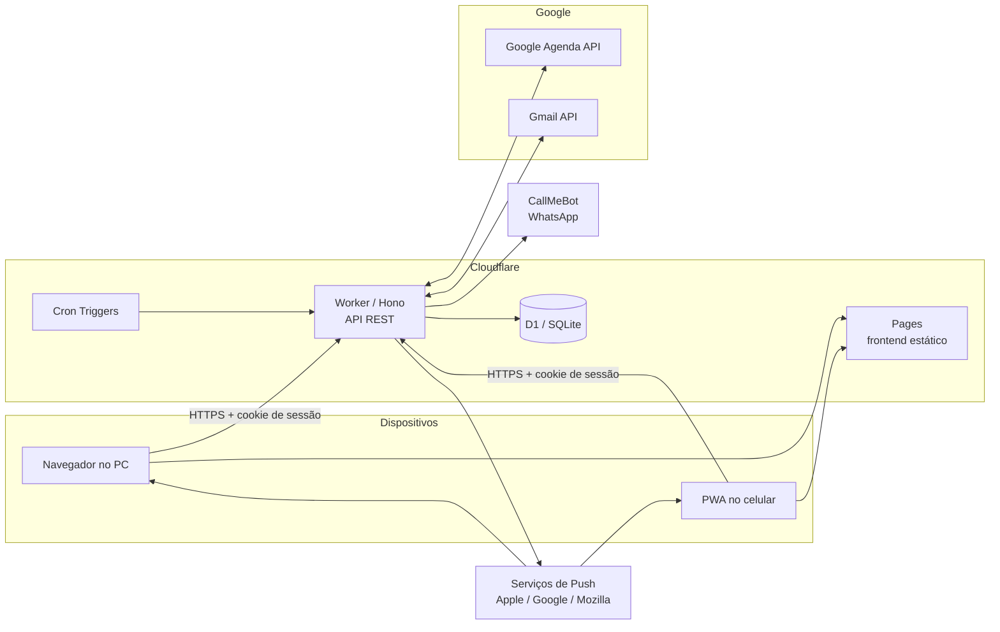
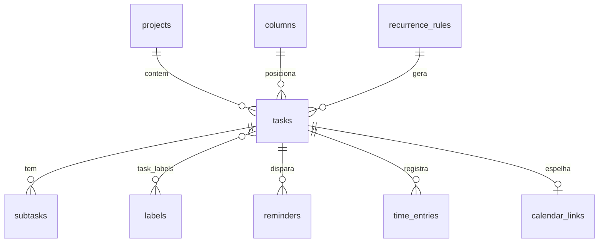

# Task Manager — Arquitetura

> Versão 1.0 · Uso pessoal (usuário único) · Custo de infraestrutura: **R$ 0**

## 1. Requisitos (definidos com o usuário)

| Tema | Decisão |
|---|---|
| Usuários | Somente o dono (1 conta Google autorizada) |
| Dispositivos | Computador + celular, sincronizados |
| Estilo principal | **Kanban**, com visões complementares de Dia / Semana / Mês |
| Volume | 5–25 tarefas/dia |
| Recorrência | Sim, com possibilidade de ajustar ocorrências individualmente |
| Integrações | Google Agenda e Gmail (nenhuma outra) |
| Lembretes | Notificação no app (push), e-mail e WhatsApp |
| Relatórios | Relatório de produtividade (fase posterior) |
| IA | Não, por enquanto |
| Custo | Zero — apenas planos gratuitos |
| Abordagem | Produto completo, construído em fases e evoluído em detalhe |

## 2. Stack escolhida

| Camada | Tecnologia | Hospedagem gratuita |
|---|---|---|
| Frontend | React + TypeScript + Vite, PWA (instalável no celular) | Cloudflare Pages |
| UI | Tailwind CSS + componentes próprios; `dnd-kit` para arrastar cartões | — |
| Estado/sincronização | TanStack Query (cache, atualização otimista, refetch ao focar) | — |
| API | Hono (TypeScript) em Cloudflare Workers | Workers Free |
| Banco de dados | Cloudflare D1 (SQLite) + Drizzle ORM (migrações tipadas) | D1 Free |
| Tarefas agendadas | Cloudflare Cron Triggers | Incluído (até 5 crons) |
| Autenticação | Google OAuth 2.0 (o mesmo login concede acesso à Agenda e ao Gmail) | Google Cloud (gratuito) |
| Push no app | Web Push padrão (VAPID) via Service Worker | Gratuito |
| E-mail | Gmail API (`gmail.send`) — envia da sua própria conta para você | Gratuito |
| WhatsApp | CallMeBot (API gratuita, uso pessoal, 1 número) | Gratuito |

### Por que Cloudflare e não as alternativas

| Alternativa | Por que foi descartada |
|---|---|
| Supabase Free | Pausa o projeto após ~1 semana sem uso; limite de 2 projetos |
| Firebase | Cloud Functions (necessárias para cron/lembretes) exigem plano pago Blaze |
| Vercel + Neon | Cron do plano gratuito é limitado a execução diária — insuficiente para lembretes |
| Site 100% estático (sem backend) | Não há como disparar lembretes com o app fechado nem guardar tokens do Google com segurança |

Cloudflare oferece frontend, API, banco e cron em um só lugar, sem pausa por inatividade, e com limites
muito acima do que um usuário único consome (100 mil requisições/dia na API; a D1 gratuita comporta milhões
de leituras por dia).

## 3. Visão geral



## 4. Componentes

### 4.1 Frontend (PWA)

Visões:

- **Kanban** (principal): colunas configuráveis — padrão `Caixa de entrada · A fazer · Hoje · Fazendo · Feito`.
  Arrastar e soltar entre colunas e para reordenar; filtros por projeto, etiqueta, prioridade e prazo.
- **Hoje**: lista e linha do tempo do dia, mostrando tarefas e eventos do Google Agenda; indicador de carga
  (horas estimadas × horas livres).
- **Semana / Mês**: calendário com tarefas agendadas e eventos; arrastar para reagendar.
- **Caixa de entrada**: tudo o que foi capturado e ainda não foi organizado (inclui o que veio do Gmail).
- **Relatórios** (fase 5).
- **Configurações**: colunas, projetos, etiquetas, canais e horários de lembrete, integrações.

Recursos transversais:

- **Captura rápida** com linguagem natural em português:
  `Pagar boleto amanhã 9h #financeiro !alta ~30min` → título, data, projeto, prioridade e duração.
  Atalho de teclado no PC (`N` ou `Ctrl+K`).
- **Modo offline**: o cache do TanStack Query é persistido em IndexedDB; alterações feitas offline entram em
  uma fila e são enviadas ao reconectar.
- **Instalável**: manifest com `display: standalone` (necessário para push no iPhone, iOS 16.4+).

### 4.2 API (Cloudflare Worker + Hono)

REST com JSON, validação com Zod (os mesmos esquemas são compartilhados com o frontend).

```
POST   /auth/google/login           inicia o OAuth
GET    /auth/google/callback        recebe o código, grava tokens, cria a sessão
POST   /auth/logout

GET    /tasks?status&project&from&to&updatedSince
POST   /tasks
PATCH  /tasks/:id                   inclui mover de coluna/posição
DELETE /tasks/:id                   exclusão lógica (deleted_at)
POST   /tasks/:id/complete
POST   /tasks/:id/time-entries      iniciar/parar cronômetro

GET|POST|PATCH|DELETE /columns, /projects, /labels
GET|POST|PATCH|DELETE /recurrences  (regras de recorrência)
PATCH  /recurrences/:id/occurrences/:date   ajustar/pular uma ocorrência

GET    /calendar/events?from&to     eventos do Google (cache local)
POST   /push/subscribe              registra um dispositivo para Web Push
GET    /reports/summary?from&to
GET    /sync?since=<timestamp>      tudo o que mudou desde o último sync
```

### 4.3 Banco de dados (D1)



Tabelas principais (todas com `id` UUID, `created_at`, `updated_at`, `deleted_at`):

| Tabela | Campos relevantes |
|---|---|
| `tasks` | `title`, `notes` (markdown), `column_id`, `position` (índice fracionário), `project_id`, `priority` (1–4), `due_at`, `scheduled_start`, `estimate_min`, `status`, `completed_at`, `recurrence_rule_id`, `occurrence_date`, `source` (`manual`/`gmail`/`recurrence`), `source_ref` (id do e-mail) |
| `subtasks` | `task_id`, `title`, `done`, `position` |
| `columns` | `name`, `position`, `color`, `maps_to_status`, `wip_limit` |
| `projects`, `labels`, `task_labels` | organização |
| `recurrence_rules` | `rrule` (RFC 5545), `timezone`, `template` (JSON da tarefa-modelo), `mode` (`fixed` / `after_completion`), `active` |
| `recurrence_exceptions` | `rule_id`, `occurrence_date`, `action` (`skip`/`override`), `override` (JSON) |
| `reminders` | `task_id`, `fire_at`, `channels` (`push`,`email`,`whatsapp`), `sent_at`, `status` |
| `time_entries` | `task_id`, `started_at`, `ended_at` (estimado × real) |
| `calendar_links` | `task_id`, `google_event_id`, `etag` |
| `calendar_events_cache` | eventos da sua agenda principal (para mostrar ocupação) |
| `push_subscriptions` | `endpoint`, `keys`, `device_name` |
| `settings` | fuso horário, horário silencioso, número do WhatsApp, padrões de lembrete |
| `oauth_tokens` | `refresh_token` **criptografado** (AES-GCM, chave em Worker Secret) |
| `sync_state` | `calendar_sync_token`, `gmail_history_id` |
| `activity_log` | eventos (criada, movida, concluída…) — base dos relatórios |

### 4.4 Recorrência

- Regras no padrão **RRULE (RFC 5545)**, o mesmo do Google Agenda — permite "todo dia útil", "toda 2ª e 4ª",
  "dia 5 de cada mês", "última sexta do mês", "a cada 3 meses" etc. Biblioteca: `rrule`.
- Dois modos:
  - **Data fixa** (`fixed`): a ocorrência existe independentemente de a anterior ter sido concluída (ex.: pagar aluguel).
  - **Após conclusão** (`after_completion`): a próxima é criada X dias depois de concluir a atual (ex.: trocar o filtro).
- **Materialização em janela**: um cron diário cria as ocorrências dos próximos 14 dias como tarefas reais,
  para que apareçam no Kanban e possam ser editadas, movidas ou excluídas uma a uma.
- **Ajustes**, como no Google Agenda: editar **só esta**, **esta e as seguintes** (divide a regra em duas)
  ou **todas**. Pular uma ocorrência grava uma exceção, e a ocorrência não é recriada.

### 4.5 Sincronização entre PC e celular

- O servidor é a fonte da verdade; cada registro tem `updated_at`.
- O cliente pede `GET /sync?since=…` ao abrir o app, ao voltar para a aba e a cada 60 s com o app aberto.
- Conflitos: **última escrita vence** por campo alterado (suficiente para um usuário em dois aparelhos).
- A ordem dos cartões usa **índices fracionários** (`a0`, `a0V`, `a1`…): mover um cartão altera só esse cartão,
  o que evita conflitos de reordenação.

### 4.6 Google Agenda (sincronização bidirecional)

- O app cria uma agenda dedicada, **"Task Manager"**, na sua conta, para não misturar com a agenda principal.
- **App → Google**: uma tarefa com horário (`scheduled_start` + `estimate_min`) vira um evento nessa agenda;
  mudanças no app atualizam o evento.
- **Google → App**: mover ou redimensionar o evento no Google Agenda atualiza a tarefa (sincronização
  incremental com `syncToken` a cada 5 min).
- **Agenda principal (somente leitura)**: seus compromissos aparecem nas visões Hoje/Semana como tempo ocupado,
  e entram no cálculo de carga do dia.

### 4.7 Gmail → Tarefa

- Você aplica o marcador **`Tarefa`** a um e-mail (no celular ou no PC).
- A cada 5 min, o cron consulta o Gmail (`history.list` a partir do último `historyId`), cria a tarefa na
  Caixa de entrada com o assunto como título, um trecho do e-mail e o **link direto para a conversa**, e troca o
  marcador para `Tarefa/Importada`.
- Opcional: concluir a tarefa arquiva o e-mail.

### 4.8 Lembretes e notificações

Um cron **a cada minuto** busca os `reminders` vencidos e envia pelos canais escolhidos:

| Canal | Como | Observação |
|---|---|---|
| Push no app | Web Push (VAPID) para todos os dispositivos registrados | No iPhone exige o app instalado na tela inicial (iOS 16.4+). Clicar abre a tarefa. |
| E-mail | Gmail API, de você para você | Também envia o **resumo diário** (agenda do dia) e o semanal |
| WhatsApp | CallMeBot (`GET` com número + apikey) | Gratuito, só texto, entrega pode levar alguns segundos. Ativação: enviar uma mensagem ao bot e guardar a apikey. |

Regras de lembrete:

- Padrões configuráveis por prioridade (ex.: P1 → push + WhatsApp 30 min antes; P3 → só push).
- Horário silencioso (ex.: 22h–7h, exceto P1).
- **Adiar** pela própria notificação ("+15 min", "amanhã").
- Tarefas atrasadas não geram contadores vermelhos; vão para uma seção "Replanejar" com reagendamento em um clique.

### 4.9 Relatórios de produtividade (fase 5)

Calculados a partir de `activity_log` e `time_entries`:

- Tarefas concluídas por dia, semana e mês; taxa de conclusão (planejadas × feitas)
- **Estimado × real** por projeto (reduz a falácia do planejamento; o app passa a sugerir estimativas pelo seu histórico)
- Tempo por projeto e por etiqueta; carga de trabalho por dia da semana
- Tempo de ciclo no Kanban (de "A fazer" até "Feito") e gargalos por coluna
- Sequência de dias de cumprimento das recorrentes
- Exportação em CSV e e-mail de resumo semanal

## 5. Crons (limite gratuito: 5)

| Cron | Frequência | Função |
|---|---|---|
| `reminders` | a cada 1 min | Disparar lembretes vencidos |
| `google-sync` | a cada 5 min | Sincronização incremental da Agenda e importação do Gmail |
| `daily` | 1x/dia (06:00 BRT) | Materializar recorrências, e-mail de resumo do dia, limpeza |
| `weekly` | domingo 18:00 BRT | Relatório semanal por e-mail |

## 6. Segurança

- **Lista de permissão de um e-mail**: só a sua conta Google consegue entrar; qualquer outra recebe 403.
- Sessão em cookie `HttpOnly; Secure; SameSite=Lax`, assinado, com 30 dias de validade.
- `refresh_token` do Google criptografado no banco; chaves (OAuth secret, VAPID, CallMeBot, criptografia) em
  **Worker Secrets**, nunca no repositório.
- Escopos Google: `openid email`, `calendar` (Agenda), `gmail.modify` (marcadores) e `gmail.send`.

### Observação sobre o OAuth do Google

- No modo **"Teste"** do Google Cloud, o token expira a cada 7 dias (seria preciso fazer login de novo toda semana).
  Por isso o app será **publicado em "Produção" sem verificação**: para uso pessoal (menos de 100 usuários) isso é
  permitido. A tela de consentimento mostrará o aviso "app não verificado", que você aceita uma única vez.

## 7. Limites gratuitos e riscos

| Item | Limite gratuito | Consumo estimado |
|---|---|---|
| Requisições Workers | 100.000/dia | ~3.000/dia (inclui 1.440 do cron de 1 min) |
| CPU por requisição | 10 ms | Operações simples de CRUD; criptografia do Web Push é nativa (WebCrypto) |
| D1 | milhões de leituras e ~100 mil escritas/dia; 5 GB | Algumas centenas de escritas/dia |
| Cron Triggers | 5 | 4 |
| CallMeBot | Uso pessoal, 1 número | 1 número |

Riscos e mitigações:

- **CallMeBot** é um serviço gratuito de terceiros, sem SLA. O canal de WhatsApp fica atrás de uma interface
  `Notifier`, então trocar por outro provedor (ou por Telegram, que é gratuito e oficial) exige só um adaptador novo.
- **CPU de 10 ms**: tarefas pesadas (relatórios grandes) serão pré-agregadas pelo cron diário.
- **Push no iPhone**: depende de o PWA estar instalado na tela inicial.

## 8. Estrutura do repositório

```
/
├── apps/
│   ├── web/                 # React + Vite (PWA)
│   └── api/                 # Worker Hono + crons
│       ├── src/routes/
│       ├── src/jobs/        # reminders, google-sync, daily, weekly
│       ├── src/integrations/  # google-calendar, gmail, webpush, callmebot
│       └── migrations/      # SQL gerado pelo Drizzle
├── packages/
│   └── shared/              # esquemas Zod, tipos, parser de linguagem natural, utilitários de recorrência
├── docs/
└── .github/workflows/       # CI: lint, typecheck, testes; deploy automático na Cloudflare
```

Monorepo com `pnpm workspaces`. Testes com Vitest (unitários no `shared` e testes de API com o runtime do Workers).

## 9. Roteiro de construção

| Fase | Entregas |
|---|---|
| **1. Fundação** | Monorepo, CI, deploy na Cloudflare, banco e migrações, login Google com lista de permissão |
| **2. Núcleo** | CRUD de tarefas, subtarefas, projetos e etiquetas; **Kanban** com arrastar e soltar; captura rápida; sincronização PC/celular; PWA instalável |
| **3. Tempo** | Visões Hoje/Semana/Mês, **recorrência completa** (RRULE, exceções, "esta / seguintes / todas"), cronômetro estimado × real |
| **4. Integrações e lembretes** | Google Agenda bidirecional, Gmail → tarefa, Web Push, e-mail, WhatsApp, resumo diário |
| **5. Relatórios** | Painel de produtividade, e-mail semanal, exportação CSV |
| **6. Refinamento** | Offline completo, atalhos de teclado, temas, ajustes de uso real |

Cada fase termina utilizável e publicada, para que você use o app e peça ajustes antes de seguir para a próxima.

## 10. O que você vai precisar criar (gratuito)

1. Conta na **Cloudflare** (gratuita).
2. Projeto no **Google Cloud Console** com as APIs Calendar e Gmail ativadas e credenciais OAuth (te guio passo a passo na fase 1).
3. Ativação do **CallMeBot** no seu WhatsApp (fase 4).
